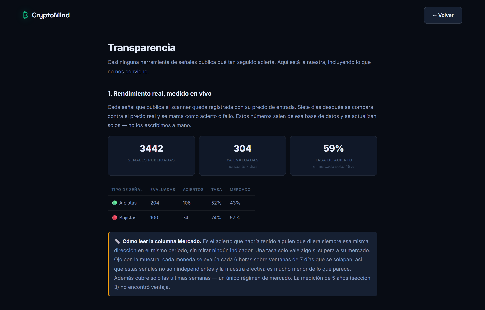

# CryptoMind

**AI-assisted crypto market analysis — web app + Telegram bot — that measured its own signal, found it had no edge, and rebuilt itself around a forecast it can actually back up.**

[](https://crypto-analista-ia.vercel.app)
[](https://t.me/cryptomind_analista_bot)
[](https://crypto-analista-ia.vercel.app/transparencia)

📄 **Case study:** [English](docs/case-study.md) · [Español](docs/caso-de-estudio.md) — the project from a client's point of view, without the math.


---

## The interesting part

Most "AI trading signal" products show a confident percentage and never say where it comes from. This one used to do the same: it displayed a **"reliability %"** computed as `40 + |score| / 8 × 40` — a transform of the indicator score, not a measurement of anything.

So I measured it.

**1. Backtest the signal that actually ships.** Five years of daily Binance data across the 10 coins the scanner watches — 16,250 observations, same 200-day rolling window as production, no look-ahead. Each signal bucket is compared against the **baseline**: how often the price moved that way anyway.

| Signal (7-day horizon) | Times right | Market baseline | Edge |
|---|---|---|---|
| Strong buy (n = 398) | **44.5%** | 47.2% | −2.7 pts |
| Buy (n = 5,600) | **45.6%** | 47.2% | −1.6 pts |
| Sell (n = 5,478) | 52.3% | 52.8% | −0.5 pts |

The signal does not beat the market. The strongest bullish calls are the *worst* ones — at 30 days, strong buys were right 37% of the time against a 44.6% baseline, outside the margin of error. It looks like mean reversion: indicators turn bullish *after* a run-up, right before it cools off.

**2. Stop selling direction. Forecast range instead.** Direction is close to unpredictable; *how much* a price moves is not, because volatility clusters. The app now gives an expected price range:

> BTC will trade between **$61,769** and **$67,056** over the next 7 days — 80% confidence

and the confidence level is **verified, not assumed**:

| Band | Crypto coverage | Equities coverage |
|---|---|---|
| 50% | 51.6% | 52.0% |
| **80%** | **82.9%** | **80.8%** |
| 95% | 96.4% | 93.4% |

Coverage is measured on the most recent 30% of the data, which the calibration never saw.


**3. Never show a percentage without its baseline.** Equities are the cautionary tale: there, strong buys were right **57%** of the time — which looks great until you notice the stocks rose 56.3% of the time on their own. Every hit rate in the app is now printed next to what the market did by itself, and the verdict badge is a rule, not a judgement call:

| Condition | Verdict |
|---|---|
| edge > 95% CI | Measured edge over the market |
| \|edge\| ≤ 95% CI | No demonstrable edge |
| edge < −95% CI | Worse than the market |

If an asset class ever calibrates better, the badge turns green on its own. The full write-up is public at **[/transparencia](https://crypto-analista-ia.vercel.app/transparencia)** (in Spanish).



---

## How the price bands are calibrated

For every day *t* and horizon *h*, the forward move is standardised by the volatility known at *t*:

```
z = ln(P[t+h] / P[t]) / (σ₃₀ · √h)
```

where σ₃₀ is the realised volatility of the previous 30 daily returns. The multiplier *k* for a confidence level *c* is the empirical *c*-quantile of |z| on the oldest 70% of the data, and the band is `P · exp(± k · σ₃₀ · √h)`.

Two deliberate choices:

- **No normal distribution.** Crypto has fat tails: the empirical *k* at 95% is 2.477 against 1.960 under normality. Using the normal curve would make the 95% band about 21% too narrow exactly when it matters.
- **The 30-day window was fixed before looking at results.** Trying several windows and keeping the best-looking one would be fitting the test set. Same rule for the signal: after it failed, no variants were tried.

---

## Features

- **Analysis page** — RSI, MACD, Bollinger Bands and moving averages over 200 days, the calibrated price range, the directional verdict with its baseline, and an AI-written explanation (premium)
- **Telegram bot** — prices, analysis and alerts from chat; a scanner publishes to a channel every 6 hours
- **Public track record** — every published signal is evaluated after 7 days, hits *and* misses, shown against the market baseline
- **Price alerts** shared between web and Telegram, after linking accounts
- **Accounts and billing** — email/password and Google OAuth, JWT, Free/Premium/Admin roles enforced in the backend, Stripe subscriptions
- **Spanish and English UI**, light/dark theme, 16 display currencies

## Architecture

```
client/  React 19 + Vite ─────────▶  server/  Node + Express ──▶ Supabase (Postgres)
                                        │
            Telegram ◀── Telegraf bot ──┤── providers/          crypto: CoinGecko
                                        │     (MarketDataProvider)  equity: EODHD
                                        ├── technicalService      indicators + score
                                        ├── calibrationService    measured hit rates
                                        ├── forecastService       calibrated price bands
                                        └── aiService             Groq · Llama 3.3 70B
```

The indicator engine takes a plain price series, so it was never crypto-specific — only the data source was. A small provider registry makes the asset class a parameter: `analyzeTechnicals(symbol, 'crypto' | 'equity')`. The reasoning, the trade-offs and the cost of equity data are recorded in [docs/ADR-001](docs/ADR-001-plataforma-multiactivo.md) (Spanish).

| Layer | Technology |
|---|---|
| Backend | Node.js, Express, Telegraf, node-cron |
| AI | Groq — Llama 3.3 70B, with an 8B fallback |
| Market data | CoinGecko (crypto), EODHD (equities, needs a paid key) |
| Frontend | React 19, Vite, React Router, Framer Motion, Chart.js |
| Database | Supabase (PostgreSQL), with an in-memory fallback |
| Payments | Stripe subscriptions + webhooks |
| Hosting | Vercel (web) + Render (API and bot) |

## Reproduce the numbers

The calibration tables are committed under `server/data/`, so the app needs no network to read them. To regenerate them:

```bash
cd server
node scripts/calibrate.js                        # directional hit rates, crypto
node scripts/calibrate-intervals.js              # price bands, crypto
node scripts/calibrate.js --asset=equity         # same, for 10 large-cap US stocks
node scripts/calibrate-intervals.js --asset=equity
```

`backtest-binance.js` is the original audit with the in-sample / out-of-sample split and the pre-registered acceptance criterion.

## Known limitations

- **Earnings jumps inflate equity bands.** A stock that gaps 15% on results carries that move in its 30-day volatility for six weeks, so its band stays too wide after earnings — and is probably too narrow right before them. Coverage still averages 80.8%, but individual bands are uneven. Not fixed yet.
- **Survivorship bias in the equity test.** The 10 stocks are today's large caps, which inflates the directional baseline. It barely affects the bands.
- **Equity research data is not production data.** The calibration scripts read Yahoo's unofficial chart endpoint, which is not licensed for commercial use. The app's equity provider targets EODHD instead, which needs a paid key — free market-data tiers generally forbid commercial use — so equities are not enabled in the live demo.
- **The live track record overlaps.** The scanner re-evaluates 7-day windows every 6 hours, so live signals are not independent and the effective sample is much smaller than the count suggests.

## Running locally

```bash
# API (port 3001)
cd server
cp .env.example .env    # fill in the variables
npm install
npm run dev

# Web (port 5173)
cd client
npm install
npm run dev
```

Run `server/schema.sql` in the Supabase SQL editor first. For Stripe webhooks locally:

```bash
stripe listen --forward-to localhost:3001/api/payments/webhook
```

> **Note:** the Telegram bot and the cron jobs only start in production (`BACKEND_URL` over https) or with `ENABLE_BOT=true`. Starting the bot locally in polling mode deletes the production webhook.

---

*CryptoMind is an analysis and information tool. Nothing it shows is financial advice.*
