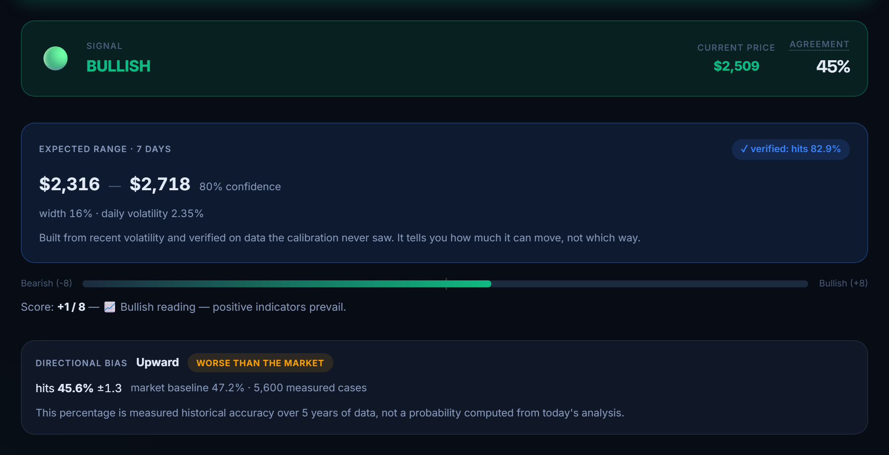

# Caso de estudio — El producto de IA que dijo la verdad sobre sí mismo

**CryptoMind** · análisis de mercado asistido por IA, app web + bot de Telegram
**Rol:** desarrollador único — producto, backend, frontend y análisis de datos
**Stack:** Node.js · React · PostgreSQL (Supabase) · Groq / Llama 3.3 · Stripe · Telegram
**En vivo:** [crypto-analista-ia.vercel.app](https://crypto-analista-ia.vercel.app) · [informe público de transparencia](https://crypto-analista-ia.vercel.app/transparencia) · [código fuente](https://github.com/JeffG025/crypto-analista-ia)

*English version: [case-study.md](case-study.md)*

---

## En pocas palabras

Construí una herramienta de IA que predecía si una criptomoneda iba a subir o bajar, y mostraba un porcentaje de "fiabilidad" junto a cada predicción. Antes de seguir vendiéndola, la puse a prueba contra cinco años de datos reales del mercado. **No funcionaba**: acertaba menos que el propio mercado.

En lugar de esconderlo, encontré la parte del problema que *sí* se puede predecir, rehíce el producto alrededor de ella y verifiqué el nuevo pronóstico con datos que nunca había visto: **cuando dice que acertará el 80% de las veces, acierta el 82.9%.**

La lección que llevo a cada proyecto: **medir antes de prometer.**

---

## El problema

El producto hacía dos promesas que no podía sostener:

- **"Esta moneda va a subir."** La app daba una señal de compra o venta a partir de indicadores técnicos estándar.
- **"Fiabilidad: 72%."** Ese número salía de una fórmula aplicada a la propia señal. Sonaba a tasa de acierto, pero nunca se había comparado con lo que realmente pasó.

La meta era un 80% de acierto, y una racha temprana de 8 aciertos de 10 hacía pensar que estaba al alcance.

## Lo que hice

### 1. Probé el producto que estaba en producción

Repetí exactamente la misma lógica sobre cinco años de precios diarios de las 10 monedas que sigue la app — 16,250 decisiones históricas — usando solo la información disponible en cada día. Después comparé cada predicción con lo que ocurrió, y con lo que hizo el mercado por sí solo.

| Señal | Acertó | El mercado solo |
|---|---|---|
| Compra fuerte | 44.5% | 47.2% |
| Compra | 45.6% | 47.2% |

Las señales de "compra fuerte" eran las peores. ¿Y la racha de 8 de 10? Con decenas de señales al día, una racha así aparece **varias veces al mes por puro azar**, aunque la señal no sirva para nada.

### 2. Cambié la pregunta

Que un precio suba o baje es casi lanzar una moneda. *Cuánto* se mueve, no: a una semana tranquila suele seguirle otra tranquila, y a una agitada, otra agitada. Así que la app dejó de prometer una dirección y empezó a dar un rango:

> *Bitcoin se moverá entre $61,769 y $67,056 en los próximos 7 días — 80% de confianza.*

Calibré esos rangos con el 70% más antiguo de los datos y los probé con el 30% más reciente, que nunca habían visto:

| Confianza prometida | Cripto, real | Acciones, real |
|---|---|---|
| 50% | 51.6% | 52.0% |
| **80%** | **82.9%** | **80.8%** |
| 95% | 96.4% | 93.4% |

### 3. Puse un punto de referencia junto a cada número

Un porcentaje solo engaña. En acciones, las señales de compra fuerte acertaban el 57% — impresionante, hasta que ves que esas acciones subieron el 56.3% de las veces de todos modos. Por eso cada tasa de acierto de la app aparece junto a lo que hizo el mercado por sí solo, y la etiqueta ("ventaja medida", "sin ventaja demostrable", "peor que el mercado") sigue una regla fija, no mi criterio.

La regla también aplica a las buenas noticias. Cuando el historial en vivo mostró un favorable **59%**, le puse al lado el **48%** del mercado, con una nota sobre por qué la muestra es más pequeña de lo que parece.

### 4. Lo entregué completo

Nueva pantalla de análisis, bot de Telegram actualizado, una página pública de transparencia y un motor que ahora funciona para acciones además de cripto. Todo desplegado, verificado en el sitio en vivo y documentado para que cualquiera pueda reproducir los números.

## Resultados

- Un **pronóstico del 80% verificado**, medido con datos que el modelo nunca vio
- **Cero números inventados** en el producto — cada porcentaje lleva al lado su referencia y el tamaño de la muestra
- **Una auditoría pública** de la señal original, fallos incluidos
- Un **motor multi-activo**: sumar acciones requirió una nueva fuente de datos, no reescribir nada

## Qué significa si trabajas conmigo

La mayoría de los proyectos de IA fallan en silencio: un chatbot que responde con seguridad y se equivoca, un panel con un número que nadie revisó. Mi forma de trabajar lo evita:

- **Pruebo antes de prometer.** Si algo no puede hacer lo que necesitas, te lo digo yo antes de que lo pagues.
- **Busco lo que sí funciona.** Aquí la respuesta honesta no fue "es imposible", sino una pregunta distinta y útil que los datos *sí* podían contestar.
- **Dejo los resultados comprobables.** Recibes los números, cómo se midieron y cómo volver a verificarlos.

---

*Los detalles técnicos — método de calibración, arquitectura y cómo reproducir cada número — están en el [README](../README.md) (en inglés).*
